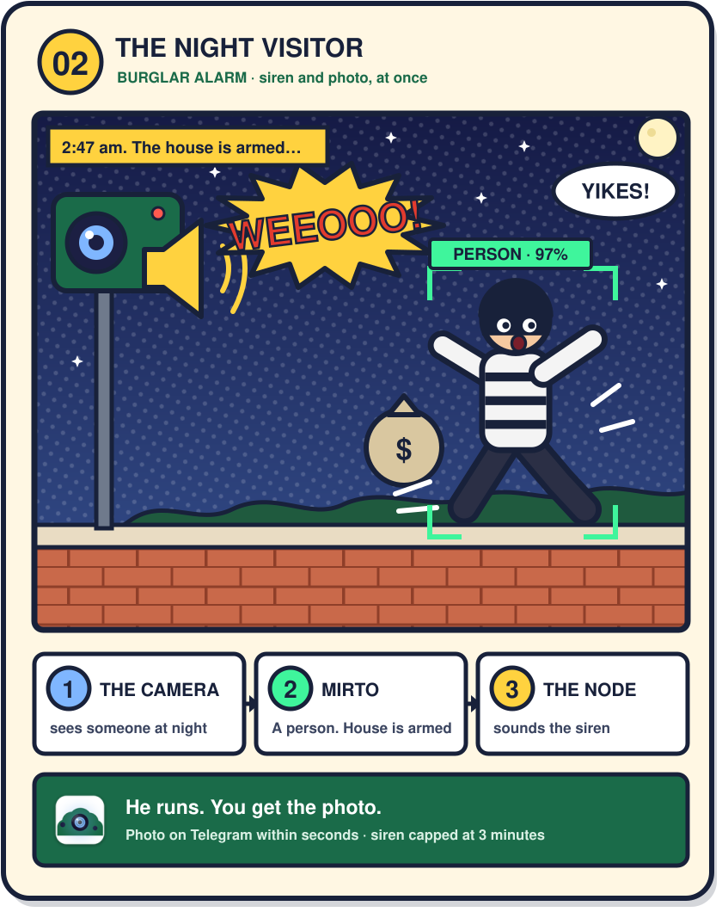
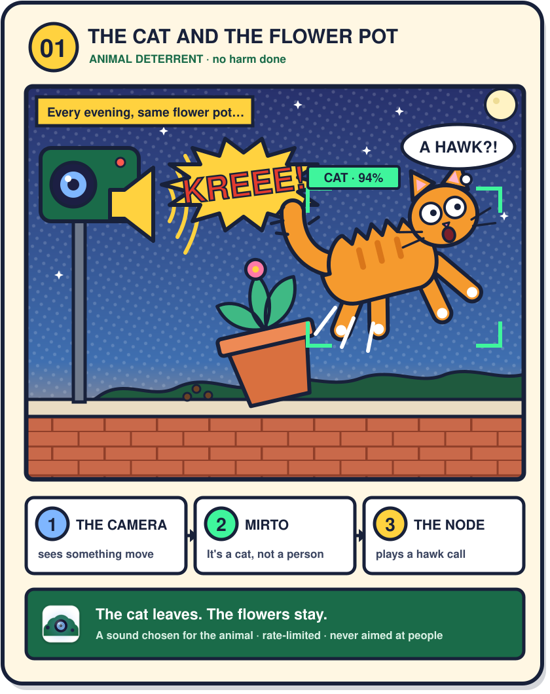
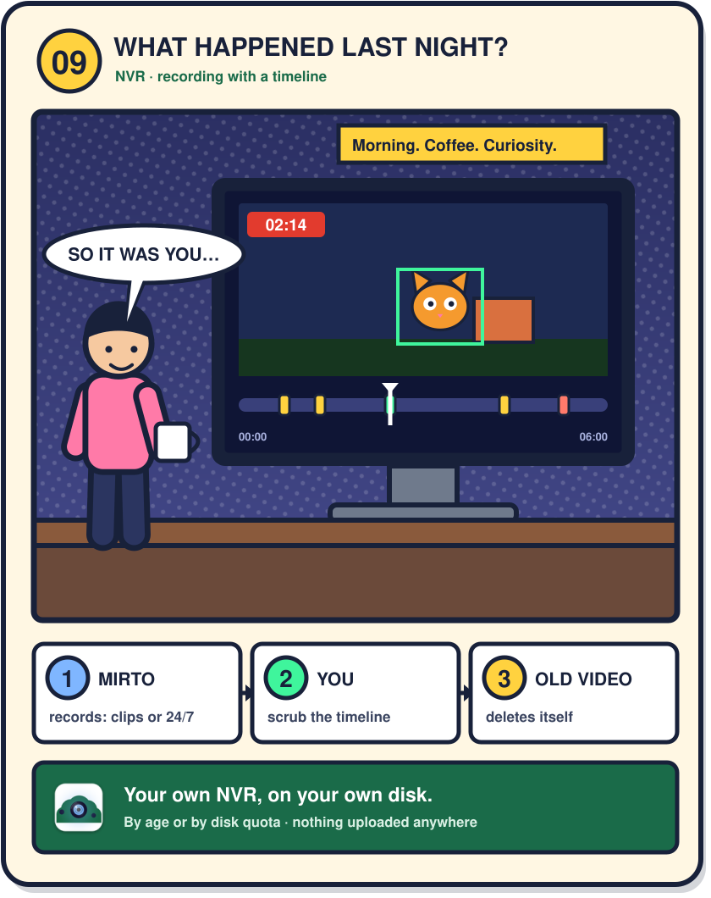
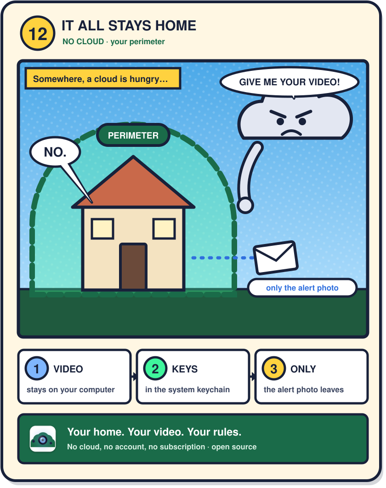

# Mirto

**Local-first desktop video surveillance for macOS and Windows.** Mirto:

- shows every camera the computer can see (built-in, USB, network RTSP);
- detects motion and checks whether a **person** is in the frame (YOLOX model, running locally);
- alerts the Mirto Admins: **photo on Telegram**, **email** with the photo attached and a link to the
  Telegram message, optional **SMS**;
- when **protection is on**, controls the outputs of external **nodes** (siren, lights, audio, generic
  relays and sockets) through signed HTTP requests.

**Guiding principle:** no third-party cloud. Video stays on your computer; only the alert snapshots leave
it, and only towards the channels you configure.

> ⚠️ Please read [Responsible use](#responsible-use) before installing: video surveillance and deterrent
> devices are regulated by law.

> 📖 User guide: [English](USER_GUIDE.md) · [Italiano](GUIDA_UTENTE.md). The app speaks English and Italian
> (Settings → General → Language; automatic from the system).

## How it works

1. **It watches.** Mirto opens every camera the computer can reach — built-in, USB, or RTSP on the
   network — and looks for movement.
2. **It checks, on your machine.** When something moves, a detection model runs locally and answers one
   question: *is that a person?* No frame leaves the computer to be looked at by anyone else.
3. **It tells you, and it can act.** Photo on Telegram within seconds, by email too, optionally by SMS.
   And if you put a **node** outside — a Raspberry Pi, from an image you write to a microSD and pair with
   a 6-digit PIN — it also has a camera out there, a siren, and lights.

## What it is for

Four ordinary evenings. [Eight more →](docs/cards.md)

| | |
|---|---|
| [](docs/cards.md#2-the-night-visitor) | [](docs/cards.md#1-the-cat-and-the-flower-pot) |
| [](docs/cards.md#9-what-happened-last-night) | [](docs/cards.md#12-it-all-stays-home) |

## What it does

| | |
|---|---|
| **Cameras** | Every camera the computer can reach: built-in, USB and network cameras, which it finds by itself. Unplug one and plug it back in: it comes back on its own, with the same identity. |
| **Person detection** | Movement wakes the detector; the detector decides whether it is a person. It runs on your Mac's Neural Engine or your Windows GPU, and nowhere else. It can watch for 80 other things too — a car, a dog, a suitcase — and tell bird species apart if you want it to. |
| **Sounds** | Breaking glass, a smoke alarm, a siren, screaming, a gunshot, a barking dog, knocking at the door. The audio is listened to and thrown away: never stored, never sent. |
| **Alerts** | A photo on Telegram within seconds, with buttons to say *false alarm* or to silence it; the same by email, optionally by SMS. If a channel is down Mirto keeps trying instead of losing the event. |
| **Recording** | Clips around each event (10 s before, 20 s after), or continuous recording, with a timeline to scrub through. Old footage deletes itself by age or when it hits the disk quota you set. |
| **Physical actions** | A Raspberry Pi node gives Mirto a siren, lights, relays and sockets in the house. Every request is signed, and the node obeys only the computer it was paired with. |
| **Deterrents** | Sounds that move animals on, not people: raptor calls, a crow alarm, a shot, or your own recordings — chosen per species, rate-limited, and never aimed at a person. |
| **When it is armed** | Arm and disarm from the app or from Telegram, on a weekly schedule, on date ranges, or by themselves when the phones of the people who live there leave the Wi-Fi. |
| **Limits you cannot switch off** | The siren stops after 3 minutes and cannot run more than 3 minutes in any 30. Every output switches itself off. Nothing unlocks anything. Deterrents never point at a person. These are enforced twice: in the app, and again in the node, which does not trust the app. |
| **Privacy** | Everything happens on your computer. Passwords and tokens live in the system keychain, never in a file. Old events delete themselves. Usage statistics exist, and are off until you say yes ([`PRIVACY.md`](PRIVACY.md)). |

<details>
<summary>The same thing with the part numbers, for whoever wants them</summary>

- **Cameras** — stable IDs across replugs (AVFoundation on macOS, Media Foundation on Windows),
  hot-plug, automatic reconnection, RTSP/HTTP network cameras, discovery via mDNS (`_rtsp._tcp`).
- **Detection** — background subtraction (MOG2) on every frame; YOLOX Nano/S through ONNX Runtime
  (CoreML on macOS, DirectML on Windows, CPU otherwise) only on motion, with multi-frame
  confirmation; 80 selectable COCO classes; bird groups through a second iNaturalist model.
- **Sounds** — YAMNet, from the computer's microphone and from USB microphones on the nodes.
- **Recording** — 1-minute MP4 segments; network cameras copied without re-encoding, local cameras
  encoded with the hardware H.264 encoder; retention by days and by disk quota; clips to Telegram,
  `/clip` for the last few seconds.
- **Alerts** — Telegram bot over long polling (no open ports), SMTP with presets (Gmail app password
  by default), generic SMS providers, retry queue, anti-spam pause.
- **Nodes** — several at once, pinned TLS certificates, HMAC-SHA256 signed requests with replay
  protection, and a node simulator that is also the reference implementation of the API.
- **The *Prank* exception** — a deterrent may be aimed at a person only through a *Prank* action,
  only while Prank mode is on on that node, only while the house is not armed, and for at most
  2 minutes per hour.

</details>

## Why not Frigate, Fregata, SecuritySpy, Blue Iris or Scrypted?

They are good programs, and for many people they are the right answer. Mirto exists for a different
starting point: *you have a computer, a camera, and something outside you would like to make a noise at.*

| | **Mirto** | **Frigate** | **Fregata** | **SecuritySpy** | **Blue Iris** | **Scrypted** |
|---|---|---|---|---|---|---|
| What it is | a desktop app you open | a Docker container you host | a native macOS port of Frigate | a mature Mac NVR | a Windows NVR | a self-hosted hub with an NVR plugin |
| Install | download, open, done | Docker Compose (or a Home Assistant app) | download, open, done | download, open, done | Windows installer | Docker / npm |
| Runs on | macOS, Windows | Linux best; **Windows not officially supported** | **Apple Silicon only** (M1+, macOS 14+) | Mac only | Windows only | Linux, macOS, Windows (via Docker) |
| Price | 0, Apache 2.0, no paid tier | 0, open source; **Frigate+** $50/year for custom models | **$10** once, a year of updates | from **£35.90** (1 camera) to **£739** (unlimited) | **$99.95** full, **$39.95** one camera, renewals from $44.95/year | open-source core, **paid NVR subscription** |
| Open source | **yes, all of it** | yes | core is Frigate (MIT); **the macOS port is proprietary** | no | no | core yes, NVR no |
| Extra hardware | none: your Mac's Neural Engine or your GPU | an accelerator is "strongly recommended" | none: Neural Engine | none | a decent GPU for many cameras | depends on the plugins |
| Phone app | **on purpose, no** — Telegram is the remote, so there is no store account and no server of ours between you and your cameras | no | **yes**, free, with Apple Watch | yes | web | its own apps |
| Drives physical devices | **yes**: nodes with siren, lights, relays, sounds | through MQTT and your automations | no | no | relays via plugins | through the home-automation platform |
| Ready-made outdoor node | **yes**: write one image to a microSD, boot it, pair it with a 6-digit PIN. Camera, siren and lights in about ten minutes | — build it yourself | — | — | — | — |
| Deterrent sounds for animals | **yes**, with limits in the code | no | no | no | no | no |
| Faces, plates | **no** | yes, built in | through Frigate+ | faces | plugins | plugins |

**Where each of them beats Mirto**, because this table is useless if it only flatters us: **Fregata** is
the closest thing to Mirto on a Mac, and for $10 it also gives you a phone app and HomeKit — if you want
notifications on a lock screen rather than in a chat, that is a real difference and it is theirs.
**SecuritySpy** has fifteen years of maturity and runs hundreds of cameras. **Frigate** has the deepest
detection stack and a real Home Assistant integration. **Blue Iris** handles more cameras on one Windows
box than we intend to. **Scrypted** speaks to every ecosystem at once. If what you want is an NVR, several
of these are better NVRs.

**What Mirto has that none of them has.** Every program in that table is software you install on a machine
you have already set up. Mirto comes with **the machine**: you write one image to a microSD, put it in a
Raspberry Pi, and a few minutes later you have a camera outside with a siren and lights on it, paired to
your computer with a 6-digit PIN — no terminal, no key to copy, and every copy of the image makes its own
identity the first time it boots. The others can drive a relay if you bring MQTT, a broker, a home
automation platform and the afternoon it takes to wire them together; none of them hands you the node.

Around that: it runs on **macOS and Windows** from the same code; the safety limits on those outputs are
written into **both** sides, so the node refuses an unsafe request even if the app asks for it; it carries
**animal deterrents** that are forbidden to point at a person; and it is **entirely open source**, with no
paid tier to grow into.

**What Mirto does not do**, so nobody finds out after installing it: no face recognition and no licence
plates (a deliberate choice: in Italy they turn a camera into something a private person usually may not
run); no HomeKit, Home Assistant or MQTT integration; no web interface; no multi-user accounts; it is not
meant for twenty cameras on one machine; on Linux it runs, but only development and tests are supported
there.

**And no phone app, which is a decision rather than a gap.** An app means a developer account in two
stores, a review queue, and — for push notifications — a server of ours sitting between your cameras and
your phone, which someone has to pay for and which would become the one place where your alerts could be
read. Telegram does that job already: no ports opened on your network, no account on anything of ours,
nothing of yours passing through us, and it works on every phone including the one you are not holding.
What you give up is a lock-screen notification that carries our name on it. We think that is the better
side of the trade; if you disagree, that is a fair reason to pick something else from the table above.

And if what you have is a **Ring, Arlo or Nest**: those are easier than all of the above, and the video
goes to somebody else's computer. That is the trade Mirto exists to refuse — it is the only claim here we
would call a principle rather than a feature.

*Prices and claims checked on 9 November 2026 for [Fregata](https://fregata.app/) and
[SecuritySpy](https://bensoftware.com/securityspy/), and on 18 October 2026 for
[Frigate+](https://frigate.video/plus/), [Frigate](https://docs.frigate.video/frigate/installation),
[Blue Iris](https://blueirissoftware.com/) and [Scrypted](https://docs.scrypted.app/) — each on the
vendor's own pages. They change, and this table is only as honest as its dates.*

## Requirements

- macOS (tested on Apple Silicon) or Windows; Linux works for development and tests.
- Python **3.11+**.
- A Telegram account for alerts; optionally a Gmail account (app password) for email.

## Quick start (macOS)

Ready-made builds — a `.dmg` for macOS and an installer for Windows — land on the
[Releases page](https://github.com/marcopogo81/mirto/releases) with 0.2.0, which is being prepared.
Until then the way in is from the sources, which is four commands:

> **While the `.dmg` is unsigned**, the first time you open it macOS says the app cannot be verified.
> Drag Mirto to Applications, try to open it, then go to **System Settings → Privacy & Security**,
> scroll to the bottom and press **Open Anyway**. From the second time it opens normally.
> (Up to macOS Sonoma a right-click on the app → *Open* was enough; from 15 it is not.)

```bash
git clone https://github.com/marcopogo81/mirto.git
cd mirto
python3 -m venv .venv
source .venv/bin/activate
pip install -r requirements.txt

python -m mirto --elenca-camere      # list cameras and their stable IDs
python -m mirto                      # start the app
```

- On first launch macOS asks for **Camera** permission for the app you start Mirto from (e.g. Terminal).
- The detection model (~3.7 MB) is downloaded from the official YOLOX release and verified with SHA-256.
- If an image stays black: `python -m mirto --diagnosi-camere` saves a test photo for each camera index.

## Quick start (Windows)

Tested on **Windows 11 Pro** with Python 3.14, on the evening of 19 October 2026 — the same run that
produced most of the Windows fixes in 0.2.0.

```powershell
winget install --id Git.Git -e
winget install --id Python.Python.3.12 -e     # then reopen PowerShell: PATH has changed

git clone https://github.com/marcopogo81/mirto.git
cd mirto
py -3.12 -m venv .venv
.\.venv\Scripts\python.exe -m pip install -r requirements.txt

.\.venv\Scripts\python.exe -m mirto --elenca-camere   # list cameras and their stable IDs
.\.venv\Scripts\python.exe -m mirto                   # start the app
```

What is different from macOS:

- **Install Python from python.org or winget, not from the Microsoft Store.** The Store build runs
  sandboxed, and a sandboxed Python may not see USB cameras at all.
- **`ffmpeg` does not have to be installed**: it comes with `imageio-ffmpeg`, which is a dependency.
  Nothing has to be added to the PATH.
- **Detection runs on the GPU** through DirectML (`onnxruntime-directml`, installed automatically on
  Windows). The *System* column says which one it chose: "GPU (DirectML)" or "CPU".
- **Secrets live in Credential Manager** (Control Panel → User Accounts → Credential Manager → Windows
  Credentials), as `Mirto` (bot token), `rtsp:<camera>@Mirto` and `node_hmac_key:<node>@Mirto`.
  Nothing secret is written to `config.yaml`.
- **Autostart is the `Run` key**: Mirto starts at login, but — unlike macOS — it is **not** restarted
  after a crash. That limit is on the roadmap (W-08).
- **One Telegram bot per computer.** Telegram lets a single program read a bot's commands, so two
  Mirto installations sharing one token take turns and `/stato` answers from whichever got there
  first. Create a second bot with BotFather for the second computer; alerts would still arrive from
  both, which is the other reason not to share.

Configuration (Telegram, email, SMS, schedules, presence, nodes) is done from **Settings** inside the app;
see chapters 4–10 of the user guide.

## Try the node actions without hardware

```bash
python -m mirto --simulatore-nodo --porta 8443 --nome-nodo ingresso
```

It prints the address, certificate fingerprint and shared key to use in *Settings → Nodes and actions*.
Run several instances on different ports to simulate several nodes. The simulator is also the
**reference implementation** of the node HTTP API.

## The Raspberry node (`node/`)

`node/` contains **Mirto Node**, the service that runs on a Raspberry Pi and executes the actions requested
by Mirto. It speaks the same signed HTTPS API as the simulator, needs only Python's standard library and system
tools, and enforces its own safety limits (siren at most 3 minutes, and 3 minutes per 30 minutes). The
node offers the **camera** (MediaMTX with a password on the stream, normal or NoIR), a **siren** on a Bluetooth,
jack, USB or HDMI speaker, and a test light (the Pi's green LED).
The service runs as the system user `mirto-node`, **unprivileged**: no shell, no capabilities, one writable
path (its own configuration). The few jobs that need root — the PIN on the microSD's boot partition, and the
recordings folder on a disk plugged in later — are done by a separate service, on request.

- One-command install: `sudo ./node/install.sh`; guided setup on the Pi with `mirto-nodo`
  (status · wifi · audio · camera · name · pair).
- **One-click pairing**: pairing is open after the installation or `mirto-nodo abbina` — it never expires
  until the node has been paired once, then 5 minutes per reopening — with a
  6-digit PIN shown by the node and a separate key for every Mac ("New node found → Pair"),
  no key to copy; the key is delivered over TLS only after the pinned certificate is checked.
- **Node image**: `mirto-nodo prepara-immagine` cleans a working node; every copy becomes unique on first boot.

Step-by-step guide: chapter 12 "Nodes" of `USER_GUIDE.md` (12.1 "Setting up a Raspberry node"); details in `node/README.md`.

## Running 24/7

- *Settings → General → Start Mirto at login* installs a LaunchAgent that restarts it if it crashes.
- Mirto prevents system sleep while running, but a MacBook with the lid closed still sleeps.
- Headless mode: `python -m mirto --senza-interfaccia`.

## Build the app

```bash
pip install pyinstaller
pyinstaller packaging/mirto.spec     # macOS → dist/Mirto.app · Windows → dist/Mirto/Mirto.exe
```

On Windows, [Inno Setup 6](https://jrsoftware.org/isinfo.php) turns that folder into an installer:

```bat
iscc /DMirtoVersion=0.2.0 packaging\mirto.iss   :: → dist\Mirto-0.2.0-setup.exe
```

Tagging `v<version>` does all of this in CI and opens a draft Release with both files, their SHA-256 sums
and a CycloneDX SBOM (`.github/workflows/release.yml`).

## Data locations (macOS)

| What | Where |
|---|---|
| Configuration | `~/Library/Application Support/Mirto/config.yaml` |
| Events, snapshots, logs, action log | `~/Library/Application Support/Mirto/` |
| Recordings | `…/Mirto/recordings/` (or the folder chosen in Settings → Recording) |
| Node certificates | `…/Mirto/nodes/` |
| Credentials | Keychain (service "Mirto"): bot token, email password, node keys, camera passwords |

## Data locations (Windows)

| What | Where |
|---|---|
| Configuration | `%LOCALAPPDATA%\Mirto\config.yaml` |
| Events, snapshots, logs, action log | `%LOCALAPPDATA%\Mirto\` |
| Recordings | `%LOCALAPPDATA%\Mirto\recordings\` (or the folder chosen in Settings → Recording) |
| Node certificates | `%LOCALAPPDATA%\Mirto\nodes\` |
| Credentials | Credential Manager → Windows Credentials: bot token, email password, node keys, camera passwords |

`%LOCALAPPDATA%` is `C:\Users\<you>\AppData\Local`. The configuration file inherits that folder's
permissions — your account, SYSTEM and the local administrators — so another standard user of the same PC
cannot read it; an administrator can, and no application can prevent that. See `SECURITY.md`.

## Tests

```bash
python -m unittest discover -s tests -t .
```

Tests using the real model need `MIRTO_MODELS_DIR` (folder with `yolox_nano.onnx`) and
`MIRTO_TEST_IMAGES` (sample images from the YOLOX repository); otherwise they are skipped.

## Responsible use

Mirto is a tool: whoever installs it is responsible for how it is used.

- **Privacy (GDPR and local rules).** Point cameras only at your own property. If they cover shared or public
  areas you need a notice sign and short retention. Tell the people living with you, including about the
  *Presence* feature that uses their phones.
- **Siren.** Mirto caps the siren at 3 minutes, but repeated false alarms may still break noise laws.
- **Software only.** Mirto controls the nodes' outputs; what you connect to them is your choice and your
  responsibility. Only connect devices that cannot hurt anyone or stop anyone from leaving. At first start
  Mirto asks you to accept the terms of use.
- **No warranty.** Mirto is not a certified alarm system and does not replace professional security. It is
  provided "as is" (see the license).

## Security

Found a vulnerability? **Please do not open a public issue**: follow [`SECURITY.md`](SECURITY.md)
— private report through GitHub, an answer within 7 days, coordinated disclosure at 90 days.
Everything in this repository is in scope, the node included.

## Support the project

Mirto is free and stays free: no paid tier, no closed features, no ads, and no cloud to sell you. If you
want to help, [GitHub Sponsors](https://github.com/sponsors/marcopogo81) covers the costs the project has
anyway — the certificates that sign the macOS and Windows downloads, hardware to test on, the update server.
Donations do not change the licence and do not buy priority: the roadmap is in [`ROADMAP.md`](ROADMAP.md).

## Contributing

See [`CONTRIBUTING.md`](CONTRIBUTING.md) for how to send a change, and [`GOVERNANCE.md`](GOVERNANCE.md) for
who decides and what will not change. Where the project is going — and what it deliberately will not do —
is in [`ROADMAP.md`](ROADMAP.md).

There is **no CLA**: contributions are Apache 2.0 and each commit carries a `Signed-off-by` line (the
[Developer Certificate of Origin](https://developercertificate.org/)), which CI checks on every pull
request.

**This project is worked on at weekends**, and it is better said than discovered: first answer within
7 days, decision within 20. Weekday silence means nothing. One maintainer at weekends is enough to keep a
program alive and not enough to make it grow, so **help is genuinely wanted** — Windows, Home Assistant
and MQTT, interface tests, translations, other hardware. The list and the reasons are in
[`GOVERNANCE.md`](GOVERNANCE.md).

## Who does what

Mirto is designed, directed and reviewed by **Marco Dalicco**. His are the requirements and the order they
are tackled in, the architecture and the security decisions, and the decisions about what Mirto will *not*
do — no faces, no licence plates, no cloud, no device that could hurt someone. His too is every test on real
hardware: cameras, Raspberry nodes, a Telegram bot, a Mac and a Windows PC, in a house where this thing is
actually on. Nothing reaches `main` without him.

Most of the code, the tests and this documentation are written by **Claude** (Anthropic), one task at a time
against a written plan, with the full test suite green before each commit. Those commits say so in their own
trailers, so `git log` tells you the same story this paragraph does:

```
Co-Authored-By: Claude Opus 5 <noreply@anthropic.com>
Claude-Session: https://claude.ai/code/session_...
```

(If you contribute and you used an AI assistant, `CONTRIBUTING.md` asks for an `Assisted-By:` trailer —
same intent, and it does not count against your change.)

We write this down for two reasons. A security project that is coy about how it was built invites mistrust
the day someone reads the commit history anyway. And it tells you where to look: what protects you here is
what a person decided, reviewed and tried in a real house — not what was typed fastest.

## License

Copyright 2026 Marco Dalicco. Licensed under the **Apache License 2.0**: see [`LICENSE`](LICENSE) and
[`NOTICE`](NOTICE). Third-party components keep their own licenses, listed in
[`THIRD_PARTY_NOTICES.md`](THIRD_PARTY_NOTICES.md). The "Mirto" name and logo are not licensed
(Apache 2.0, section 6).

Icons: [Lucide](https://lucide.dev) (ISC). Detection model: [YOLOX](https://github.com/Megvii-BaseDetection/YOLOX) by Megvii (Apache 2.0).
