# What Mirto is for — twelve small stories

Twelve ordinary evenings, and what Mirto does about them. Each card ends with the one line that
matters: what you get, and what it costs you in privacy.

If you only read one, read [the last](#12-it-all-stays-home): it is the only claim here we would call
a principle rather than a feature.

← [Back to the README](../README.md)

---

### 1. The cat and the flower pot
*Animal deterrent — no harm done.*

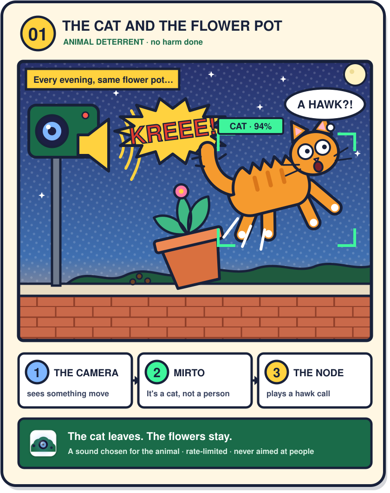

### 2. The night visitor
*Burglar alarm — siren and photo, at once.*

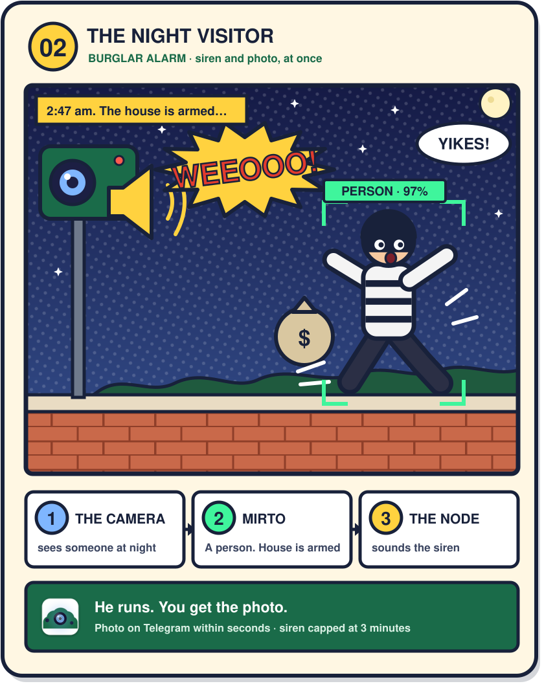

### 3. The broken window
*Sound recognition — breaking glass.*

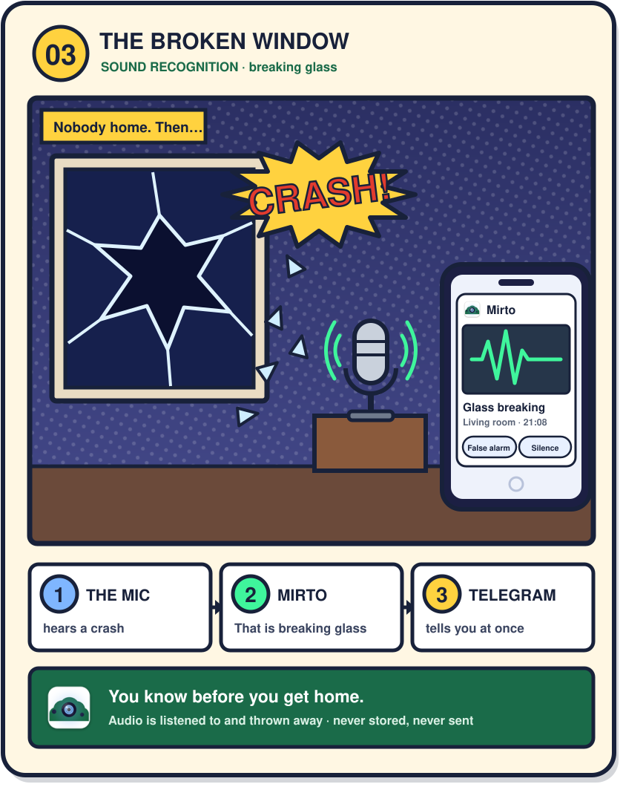

### 4. The alarm nobody hears
*Sound recognition — smoke alarm.*

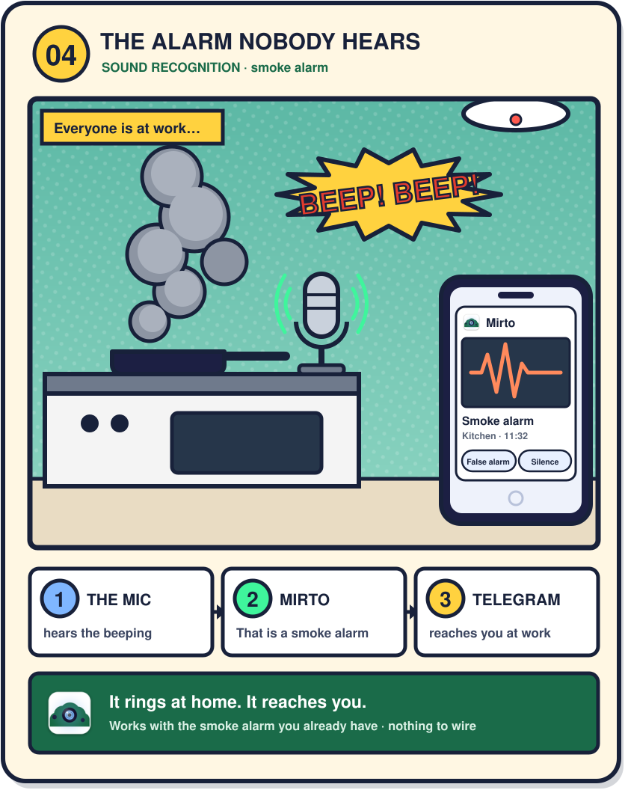

### 5. The balcony squatters
*Animal deterrent — chosen per species.*

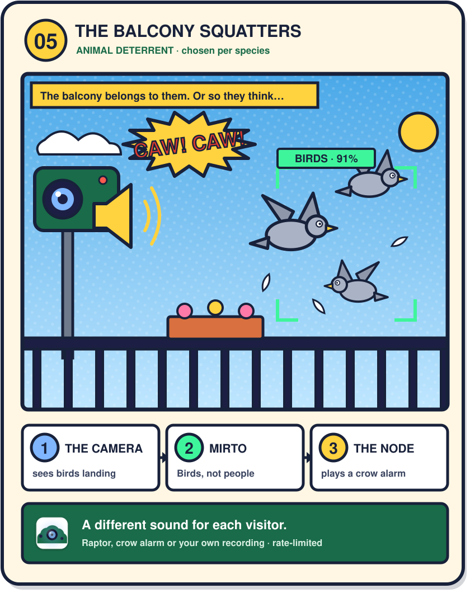

### 6. The car in the driveway
*80 objects — not only people.*

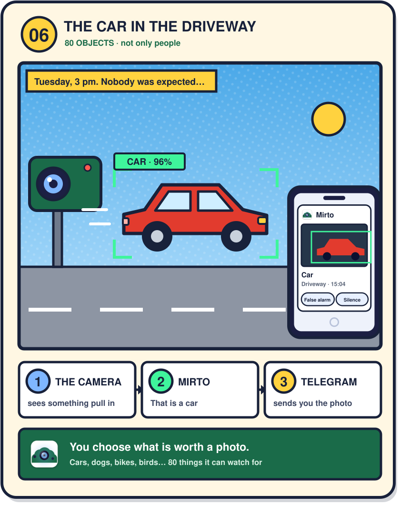

### 7. Everybody's out
*Presence — it arms itself, and disarms itself.*

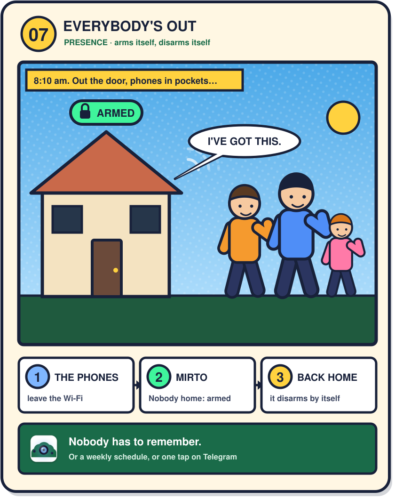

### 8. False alarm
*Telegram is the remote — no app of ours.*

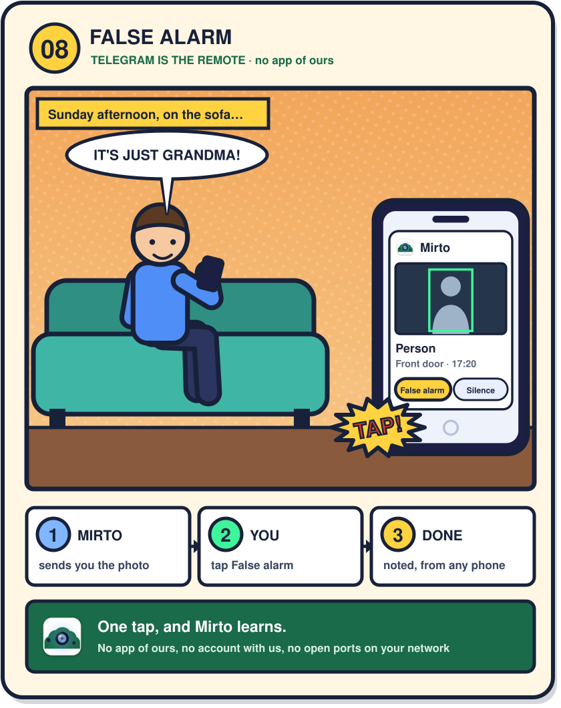

### 9. What happened last night?
*NVR — recording with a timeline.*

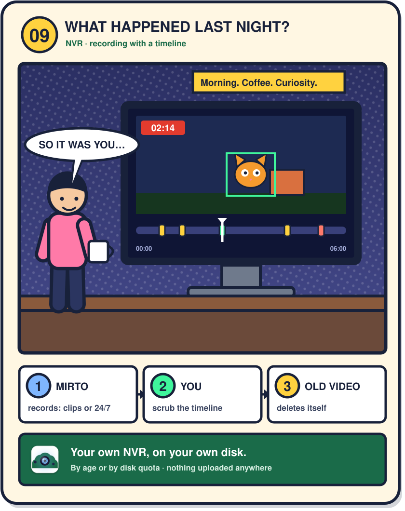

### 10. The computer is off
*The node — it records on its own.*

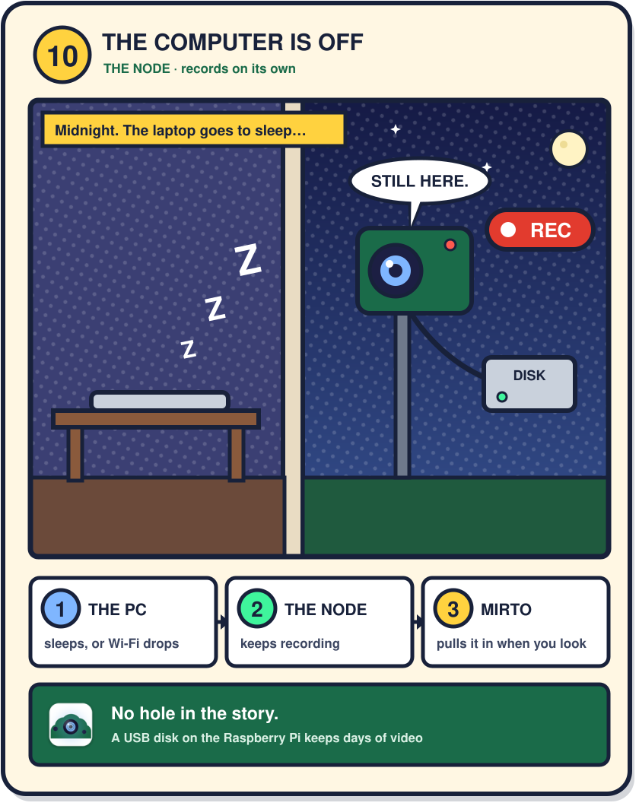

### 11. Rex has something to say
*Sound recognition — barking, knocking, sirens.*

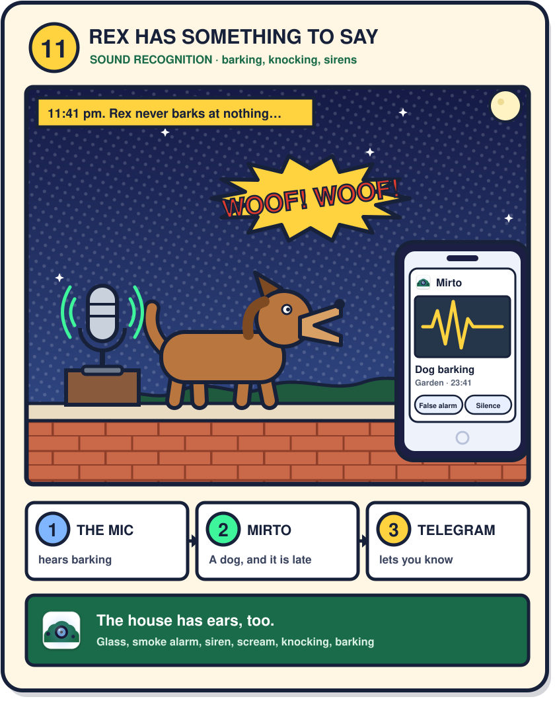

### 12. It all stays home
*No cloud — your perimeter.*

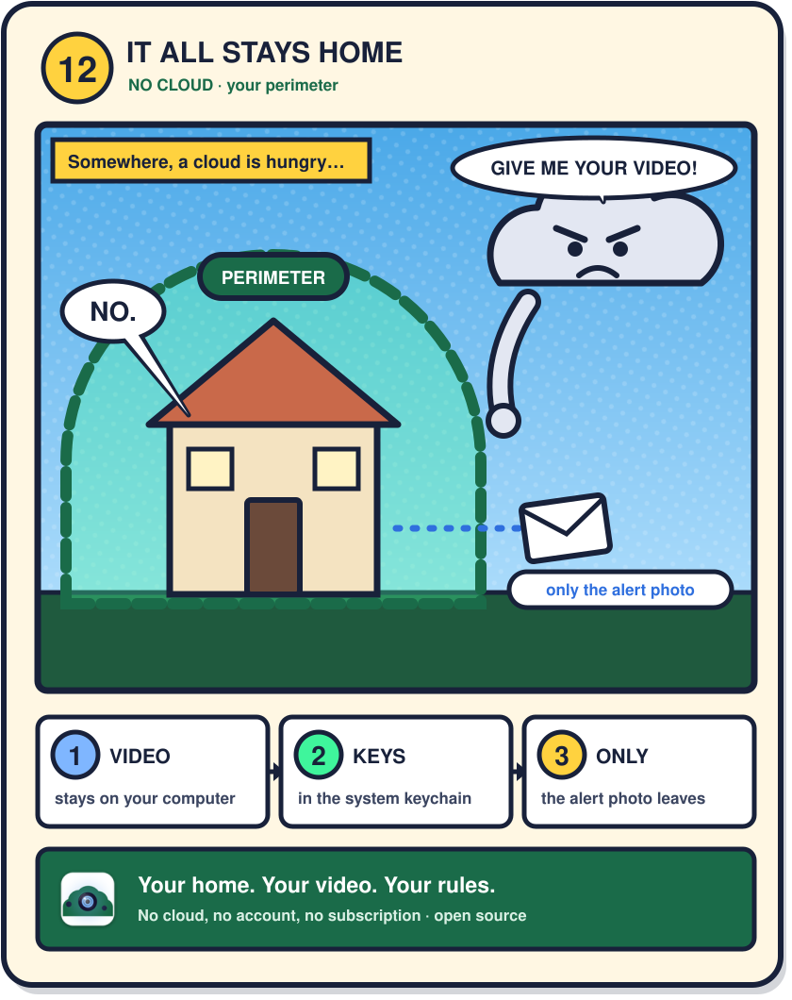

---

**A note on honesty.** The percentages in the detection boxes are made up for the drawing. Everything
else is something Mirto does today: if a card describes a behaviour, you will find it in the
[user guide](../USER_GUIDE.md), and if you find one that does not match, that is a bug in the card and
we want to hear about it.
